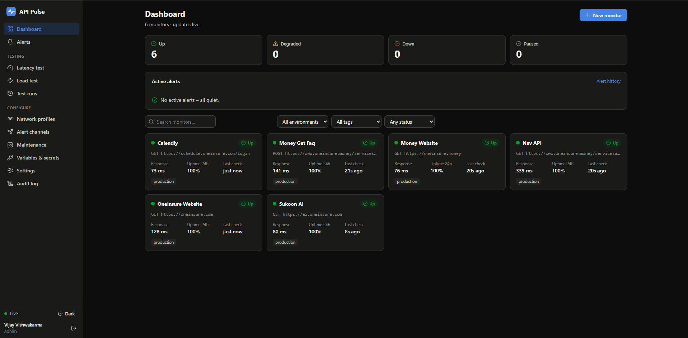
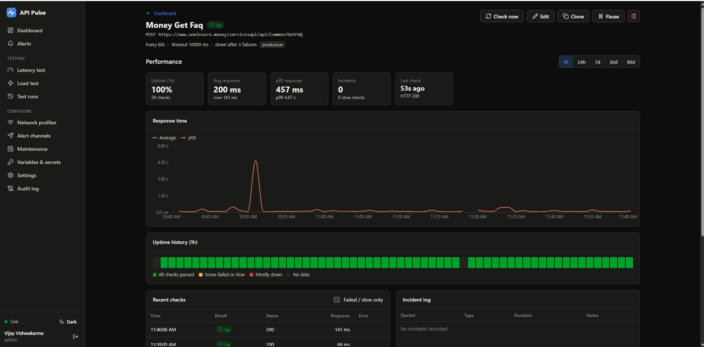
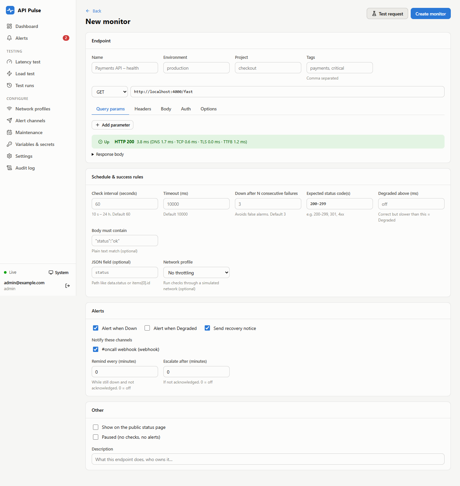
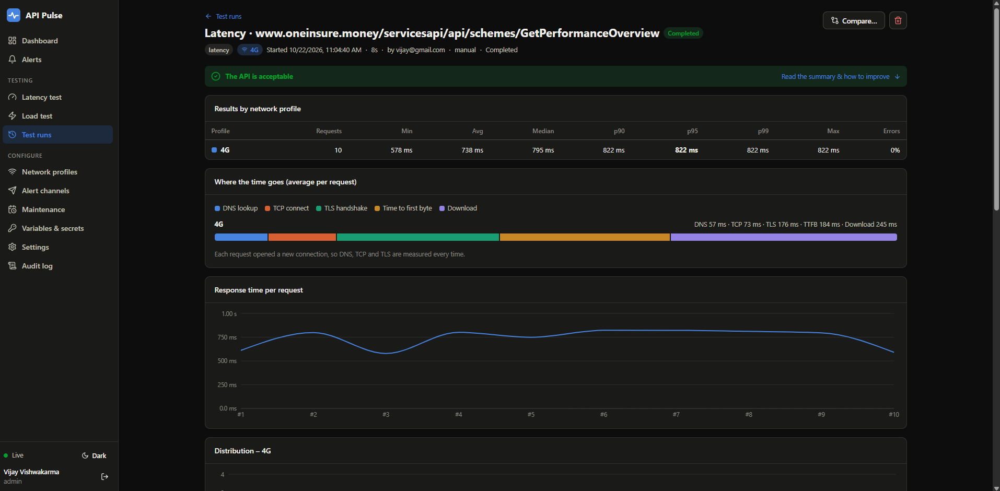
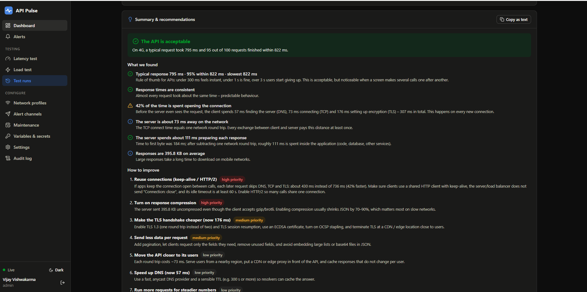
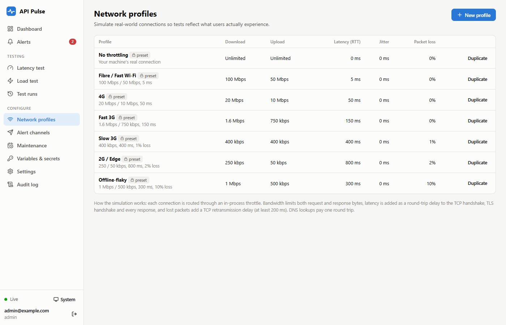
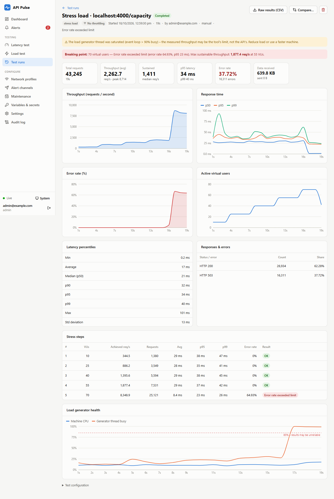
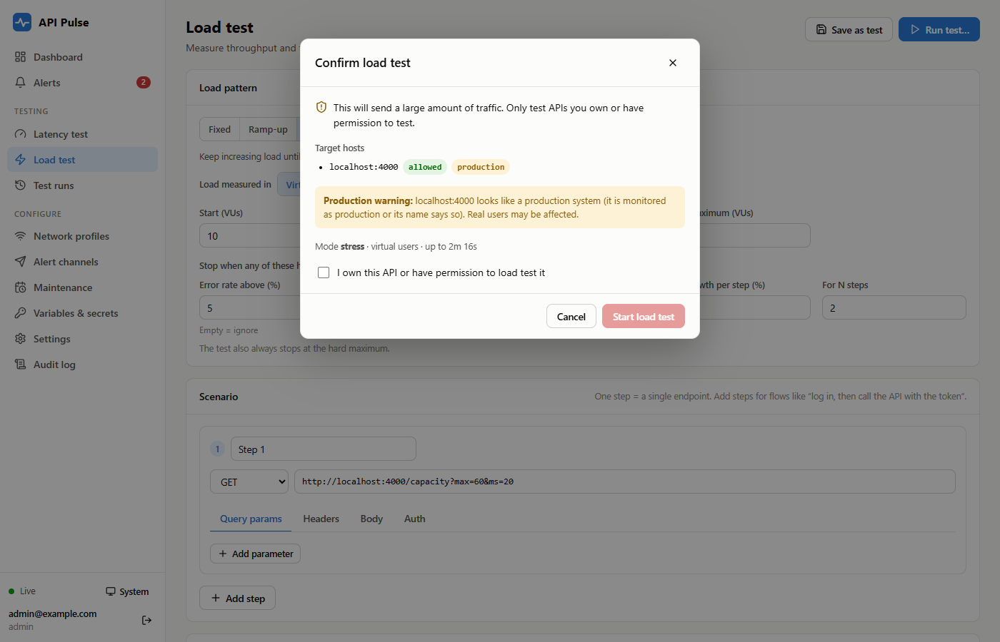
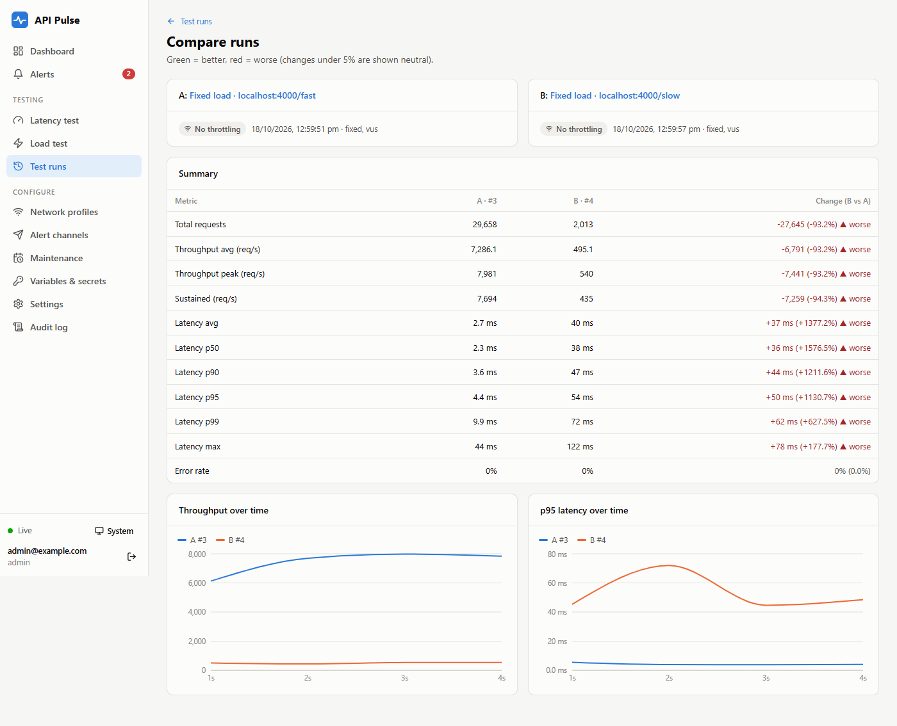
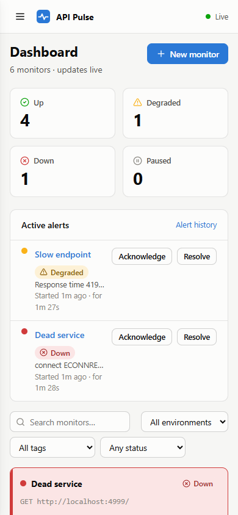

# API Pulse

**Self-hosted API monitoring, latency testing on simulated networks, and load / stress testing – in one dashboard.**

API Pulse tells your team, on a single screen, whether your APIs are **up**, **how fast** they respond for real users (from fibre to 2G), and **how much traffic** they can take before they break. It replaces three separate tools – an uptime monitor, a latency tester and a load-testing tool – with one app you run on your own server. No SaaS, no per-check pricing, and your data never leaves your infrastructure.



---

## Contents

- [Why API Pulse?](#why-api-pulse)
- [Who is it for?](#who-is-it-for)
- [What you can do with it](#what-you-can-do-with-it)
- [Feature tour](#feature-tour)
- [Setup guide](#setup-guide)
- [Your first 10 minutes](#your-first-10-minutes)
- [Configuration reference](#configuration-reference)
- [Use it from CI/CD](#use-it-from-cicd)
- [How the measurements work](#how-the-measurements-work)
- [Architecture & project layout](#architecture--project-layout)
- [Security](#security)
- [Troubleshooting](#troubleshooting)
- [Roadmap](#roadmap)

---

## Why API Pulse?

Teams usually find out about outages and slowdowns **from their users**:

- **Outages are noticed late.** Nobody is watching every endpoint, all the time.
- **Performance is measured on the office network.** Real users on mobile data get a much slower product than developers see.
- **Load testing needs scripting skills** and is done ad hoc, so results are not kept or compared between releases.

API Pulse fixes all three in one place:

| Problem | What API Pulse does |
| --- | --- |
| “Is it down?” | Checks every endpoint on a schedule (every 10 s – 24 h) and shows Up / Degraded / Down live. Sends alerts to Slack, Teams, email or a webhook. |
| “Is it fast for real users?” | Measures latency phase by phase (DNS, TCP, TLS, server time, download) on simulated networks – Fibre, 4G, 3G, 2G or your own profile. |
| “How much load can it take?” | Runs fixed, ramp-up, **stress**, spike and soak tests without writing code, and reports the **breaking point**. |
| “What do these numbers mean?” | Every test ends with a **plain-language summary**: a verdict, what was found, and prioritised steps to improve. |

Everything is configurable from the UI (or a YAML file), so a new monitor takes under two minutes and a first load test under five.

---

## Who is it for?

| Role | How they use API Pulse |
| --- | --- |
| **Backend developers** | Check how a new endpoint behaves on slow 3G before shipping; see whether time goes into DNS/TLS, the server, or the payload; get concrete fixes (keep-alive, compression, caching…). |
| **QA / performance engineers** | Run latency and load tests before each release, save them as reusable tests, compare two runs side by side to catch regressions. |
| **SRE / DevOps / on-call** | See at a glance which API is down, get alerted on Slack/Teams/email, acknowledge and resolve incidents, silence alerts during maintenance. |
| **Engineering managers** | Review uptime % and latency trends over 7/30/90 days; share a public status page. |
| **Product managers** | Understand what users on mobile networks actually experience. |
| **Small teams & startups** | Get uptime monitoring + performance testing without paying for three SaaS subscriptions. |

---

## What you can do with it

As a developer, you can:

- **Monitor any HTTP/HTTPS API** – method, headers, query params, body, Bearer / Basic / API-key auth, expected status codes, “body must contain”, JSON-field checks, and a “degraded above X ms” threshold.
- **Avoid false alarms** – an API is marked Down only after N consecutive failures (default 3).
- **Get alerted where you work** – Slack, Microsoft Teams, email (SMTP) or signed webhooks; reminders while still down, escalation if nobody acknowledges, and maintenance windows that silence planned downtime.
- **Measure real-user latency** – up to 10,000 requests per run, min / avg / median / p90 / p95 / p99 / max, a histogram, a per-request timeline, and a DNS → TCP → TLS → TTFB → download breakdown.
- **Simulate mobile networks** – compare No throttling, Fibre, 4G, Fast 3G, Slow 3G, 2G and Offline-flaky side by side, or create your own profile (bandwidth, latency, jitter, packet loss).
- **Load test without scripts** – virtual users or requests/second; fixed, ramp-up, stress, spike and soak modes; live charts; a one-click stop button.
- **Find the breaking point** – stress mode keeps adding load until the error rate, p95 latency or a throughput plateau crosses your limit, then reports the maximum sustainable throughput.
- **Test real user flows** – multi-step scenarios (e.g. log in → use the token → call the API) with values extracted from responses and test data from a CSV file.
- **Understand the result** – an automatic summary explains the outcome and lists what to fix first.
- **Catch regressions** – save tests, schedule them nightly, compare runs, and fail your CI pipeline when p95 or the error rate gets worse.
- **Keep configuration in Git** – export / import everything as YAML or JSON; use `{{VARIABLES}}` and encrypted secrets.
- **Export raw data** – download every request of a load test as CSV and verify the percentiles yourself.

---

## Feature tour

### Live dashboard
Every monitor with its status, current response time, 24-hour uptime and last check. Down APIs are sorted to the top and highlighted; active alerts sit above the list. Updates arrive live (Server-Sent Events) – no refresh needed. Filter by environment, tag or status, or search by name.


### Monitor details
Response-time chart (average and p95), uptime history, recent checks with pagination and a “failed / slow only” filter, and an incident log. Time ranges: 1 h, 24 h, 7 d, 30 d, 90 d.



### Create a monitor without code
URL, method, headers, body and auth; success rules; check interval; alert channels; reminders and escalation. **Test request** tries it before you save.



### Latency tests with phase breakdown
See exactly where the time goes for each request: DNS lookup, TCP connect, TLS handshake, time to first byte and download – on any network profile.



### Plain-language summary & recommendations
Every run ends with a verdict, “what we found” and “how to improve” – prioritised, specific and written for people new to performance testing. A built-in glossary shows what each term means **and its value in this test**. One click copies the summary as text for Slack or a ticket.



### Network profiles
Seven presets plus your own. Bandwidth limits apply to both request and response, so large payloads are slowed realistically.



### Load & stress tests
Live throughput, latency (p50 / p95 / p99), error rate and active users. Stress mode reports the breaking point, the maximum sustainable throughput, and a step-by-step table. API Pulse also warns when **the testing machine itself** becomes the bottleneck.



### Safe by default
Load tests only run against hosts on an admin-managed **allow-list**, after a confirmation step that warns about production systems – so nobody accidentally load-tests a third-party API.



### Compare runs
Put two runs side by side to see what got better or worse between releases.



### And more
- **Light & dark themes**, and works on mobile screens.
- **Roles:** Admin, Editor, Viewer – plus a full **audit log** of who created, changed or ran what.
- **Public status page** (`/status`) for the monitors you choose.
- **Data retention** with hourly rollups (raw checks 30 days, rollups 1 year – configurable).



---

## Setup guide

API Pulse runs as **one container** (or one Node.js process) with a SQLite database. No external database, queue or cache is needed.

### Requirements

- **Docker** 24+ with Docker Compose – recommended, **or**
- **Node.js 20+** and npm 10+ to run without Docker
- 1 vCPU / 512 MB RAM is enough for monitoring; give load testing **2–4 vCPUs**

### Option A – Docker (recommended)

```bash
# 1. Get the code
git clone https://github.com/exploretechvijay/API-Pulse.git
cd API-Pulse

# 2. Create your settings file
cp .env.example .env

# 3. Set an encryption key for stored secrets (any long random string)
node -e "console.log(require('crypto').randomBytes(32).toString('base64'))"
#    → paste the output into .env as APP_SECRET=...

# 4. Start
docker compose up -d
```

Open **http://localhost:8080**. The first visit asks you to create the **admin account**. Alternatively, set `ADMIN_EMAIL` and `ADMIN_PASSWORD` in `.env` before starting.

Useful commands:

```bash
docker compose logs -f api-pulse       # follow the logs
docker compose restart api-pulse       # restart
docker compose down                    # stop (data is kept in the pulse-data volume)
git pull && docker compose up -d --build   # upgrade (migrations run automatically)
```

The container restarts automatically if it crashes, and all monitors resume from the database.

### Option B – Node.js (no Docker)

```bash
git clone https://github.com/exploretechvijay/API-Pulse.git
cd API-Pulse
npm install          # installs server + web dependencies
npm run build        # builds the web UI into web/dist
npm start            # → http://localhost:8080
```

Data is stored in `./data`. To keep it running in the background, use a process manager such as **pm2** (`pm2 start server/src/index.js --name api-pulse`) or a systemd service.

**Developing on API Pulse itself:** run `npm run dev:server` (API with auto-reload on :8080) and `npm run dev:web` (Vite on :5173, proxies `/api`). Run the tests with `npm test`.

### Option C – Production with HTTPS

The UI should be served over HTTPS. Pick one:

1. **Bundled Caddy** (automatic Let's Encrypt certificates). In `.env` set:
   ```ini
   DOMAIN=pulse.example.com
   BASE_URL=https://pulse.example.com
   TRUST_PROXY=true
   SECURE_COOKIES=true
   ```
   Point the domain's DNS at the server, open ports 80/443, then run:
   ```bash
   docker compose --profile https up -d
   ```
2. **Your own reverse proxy** (nginx, Traefik, a cloud load balancer): proxy to port 8080, **disable response buffering for `/api/stream`** (live updates use Server-Sent Events), and set `TRUST_PROXY=true` and `SECURE_COOKIES=true`.
3. **Built-in TLS:** mount your certificate and set `TLS_CERT_FILE` / `TLS_KEY_FILE`.

### Backups

Everything lives in the `pulse-data` volume (`/data` in the container, `./data` without Docker):

- `api-pulse.db` – the SQLite database
- `secret.key` – the encryption key (only created when `APP_SECRET` is not set)
- `runs/` – raw per-request results of load tests (CSV, gzip)

Back up that folder, and keep `APP_SECRET` safe – without it, stored secrets (tokens, passwords, webhook URLs) cannot be decrypted.

---

## Your first 10 minutes

1. **Create a monitor** – *Dashboard → New monitor*. Enter a name and URL, click **Test request** to try it, then **Create monitor**. The first check runs immediately.
2. **Add an alert channel** – *Alert channels → New channel* (Slack/Teams incoming webhook, SMTP email or a webhook). Click **Send test**, then select the channel on your monitors.
3. **Run a latency test** – *Latency test*, paste a URL, pick **No throttling**, **4G** and **Slow 3G**, then **Run test**. Read the **Summary & recommendations** at the bottom.
4. **Allow a host for load testing** – an admin adds it under *Settings → Load-test allow-list* (`localhost` is allowed by default).
5. **Run a stress test** – *Load test → Stress*, set a stop condition (for example “error rate above 5%”), **Run test…**, confirm. Watch the live charts; the report shows the breaking point.
6. **Save it** – click **Save as test** to re-run it with one click, schedule it nightly, or trigger it from CI.

**Want to try it without a real API?** Start the bundled demo API:

```bash
npm run mock-api        # http://localhost:4000
```

| Endpoint | Behaviour |
| --- | --- |
| `GET /health` | `200`, or `503` after `POST /toggle` – try a monitor going down and recovering |
| `GET /slow?ms=800` | Answers after a delay – try the Degraded state |
| `GET /flaky?rate=0.3` | Fails 30% of requests |
| `GET /big?kb=500` | Large response – compare network profiles |
| `GET /capacity?max=50` | Returns 503 above 50 concurrent requests – find its breaking point with a stress test |
| `POST /login` → `GET /me` | Token flow for multi-step scenarios |

> With Docker, `localhost` inside the container is the container itself. To monitor services on your machine, use `http://host.docker.internal:PORT`.

---

## Configuration reference

### Environment variables

| Variable | Default | Purpose |
| --- | --- | --- |
| `APP_SECRET` | – (key file generated) | Encryption key for secrets at rest |
| `PORT` / `HOST` | `8080` / `0.0.0.0` | Listen address |
| `DATA_DIR` | `./data` | Database, key file and raw load-test results |
| `BASE_URL` | – | Public URL used for links in notifications |
| `ADMIN_EMAIL`, `ADMIN_PASSWORD` | – | Create the first admin on start |
| `TRUST_PROXY` | `false` | Trust `X-Forwarded-*` from a reverse proxy |
| `SECURE_COOKIES` | `false` (`true` with TLS files) | Secure flag on the session cookie |
| `TLS_CERT_FILE`, `TLS_KEY_FILE` | – | Serve HTTPS directly |
| `CONFIG_FILE` | – | YAML/JSON config merged on every start |
| `SESSION_TTL_HOURS` | `168` | Session lifetime |
| `CPU_WARN_PERCENT` | `85` | Flag load results when the machine's CPU is above this |
| `TZ` | `UTC` | Time zone for daily scheduled tests |

Monitor defaults (interval, timeout, failure threshold), data retention, the load-test allow-list and the public status page are set in the UI under **Settings**.

### Configuration as code

*Settings → Import / export* downloads the whole configuration (monitors, channels, network profiles, maintenance windows, saved tests, variables and settings) as **YAML or JSON**. Secrets are masked unless an admin chooses to include them.

- Objects are matched by **name**, so importing the same file again updates instead of duplicating.
- **Replace** mode also deletes items that are not in the file.
- Set `CONFIG_FILE` to apply a file on every start (GitOps style).

See [examples/api-pulse.config.yaml](examples/api-pulse.config.yaml) for a complete example.

### Variables & secrets

Define `BASE_URL`, `API_TOKEN` and so on under *Variables & secrets*, then use `{{BASE_URL}}/health` or `Bearer {{API_TOKEN}}` in any URL, header, body or auth field. Values are encrypted at rest; secrets are never shown again in the UI or in exports. Built-in dynamic values: `{{$timestamp}}`, `{{$timestampMs}}`, `{{$isoTimestamp}}`, `{{$uuid}}`, `{{$randomInt}}`.

---

## Use it from CI/CD

1. Save a latency or load test with **pass criteria** (for example p95 ≤ 500 ms, error rate ≤ 1%).
2. Create an API token under *Settings → API tokens & CI*.
3. Call it from your pipeline and fail the build when the test fails:

```bash
RESULT=$(curl -sf -X POST "$PULSE_URL/api/templates/$TEST_ID/run?wait=true" \
  -H "Authorization: Bearer $API_PULSE_TOKEN" \
  -H "Content-Type: application/json" -d '{"confirm": true}')
echo "$RESULT" | jq '.summary.criteria'
test "$(echo "$RESULT" | jq -r '.passed')" = "true"
```

Without `?wait=true` the call returns at once with the run ID; poll `GET /api/runs/<id>` instead. Everything in the UI is available through the same REST API under `/api`.

---

## How the measurements work

- **Phase timings.** Each request records DNS lookup, TCP connect, TLS handshake, time to first byte (from connection ready to the first response byte, including sending the request) and download. Reused keep-alive connections report 0 for DNS/TCP/TLS.
- **Percentiles.** Nearest-rank method on every raw sample. The raw results of every load test can be downloaded as CSV (`elapsed_ms, latency_ms, status, error, stage, step`) to reproduce them. Latency statistics include every request that got an HTTP response; network errors and timeouts count towards the error rate.
- **Network simulation.** Connections go through an in-process throttle underneath TLS:
  - Each direction is a serial link at the profile's bandwidth.
  - The profile latency is a round-trip time (half each way) that also delays TCP connect, DNS and every TLS exchange.
  - Jitter varies per segment while keeping order.
  - Packet loss adds a TCP retransmission delay (max(200 ms, 2 × RTT)) per lost 1460-byte segment, which models TCP behaviour rather than dropping bytes.

  For kernel-level accuracy, run API Pulse on a Linux host shaped with `tc netem`.
- **Load model.**
  - *Virtual users* repeat iterations back to back (closed model).
  - *Requests per second* starts iterations at a fixed rate, capped by a maximum concurrency, and reports any iterations it had to drop (open model).
  - Load generation runs in a worker thread with keep-alive connection pools. One thread typically drives 5,000–13,000 req/s against a fast endpoint.
- **Self-overhead.** When the machine's CPU is above 85% or the generator thread is saturated, the run is flagged: the limit you measured may be the tool's, not the API's.
- **Stress mode.** Load goes up by one step every *step duration*. The test stops when:
  - the step's error rate or p95 crosses your limit (checked every second after 3 s),
  - throughput grows by less than X% for N steps, or
  - the hard maximum is reached.

  The step that broke is reported as the **breaking point**; the best passing step is the **maximum sustainable throughput**.

---

## Architecture & project layout

```
┌──────────────────────────── one container / one process ───────────────────────────┐
│  REST API (Express) + live updates (SSE)                                            │
│  Scheduler → monitor checks → state machine → alert service → Slack/Teams/email/... │
│  Test manager → worker threads (latency + load engine, network simulator)          │
│  SQLite (WAL) + raw results in data/runs/        React dashboard served statically │
└─────────────────────────────────────────────────────────────────────────────────────┘
```

| Part | Technology |
| --- | --- |
| Backend | Node.js 20, Express, ES modules |
| Database | SQLite (better-sqlite3, WAL mode), hourly rollups + retention |
| Live updates | Server-Sent Events |
| Load engine | Built in, runs in `worker_threads` |
| Frontend | React 18, React Router, Recharts, Vite |
| Packaging | Docker (multi-stage), Docker Compose, optional Caddy for HTTPS |

```
server/                 Node.js API, scheduler, alerting, load engine
  src/http/             HTTP client with phase timings + network simulator
  src/monitor/          monitor model, rules & state machine, scheduler, stats & retention
  src/alerts/           alert lifecycle, channel adapters, maintenance windows
  src/tests/            latency & load engines, run manager, scheduled tests
  src/routes/           REST API
  test/                 unit tests (node --test)
web/                    React dashboard (Vite)
  src/insights.js       rules that turn results into the plain-language summary
tools/mock-api.js       demo / test API
examples/               sample configuration file
deploy/Caddyfile        optional HTTPS reverse proxy
docs/screenshots/       images used in this README
```

---

## Security

- **Login required.** Passwords are hashed with bcrypt and sessions use HttpOnly cookies. Login attempts are rate-limited.
- **Roles.**
  - **Admin:** everything, including users, settings, the allow-list and config import.
  - **Editor:** create and edit monitors, tests and channels; run tests; acknowledge alerts.
  - **Viewer:** read-only.
- **Secrets encrypted at rest** (AES-256-GCM): auth tokens, passwords, webhook URLs and secret variables. They are masked in the UI, the API and exports.
- **Responsible load testing.** There is an admin-managed host allow-list, a confirmation step and a production warning, and only one load test can run at a time.
- **Audit log** of every create, change, run, login and export.
- **Hardening.** Security headers (CSP, X-Frame-Options and others), protection against cross-site requests, and a non-root container user.

---

## Troubleshooting

| Symptom | Fix |
| --- | --- |
| Load test refused with 403 | The host is not on the allow-list – *Settings → Load-test allow-list* (admin). |
| Monitor of a local service is Down in Docker | Use `http://host.docker.internal:PORT` instead of `localhost`. |
| Dashboard does not update live behind a proxy | Disable response buffering for `/api/stream` (nginx: `proxy_buffering off;`). |
| Logged out immediately over HTTPS | Set `SECURE_COOKIES=true` and `TRUST_PROXY=true` when behind a proxy. |
| “Testing machine was a bottleneck” warning | Run API Pulse on a machine with more CPU, closer to the API, and not on the same host as the API. |
| Secrets cannot be decrypted after moving servers | Restore the same `APP_SECRET` (or the `secret.key` file). |

---

## Roadmap

- Distributed load generation from several worker machines
- SMS and phone-call alerts (today: use a webhook to your SMS gateway)
- More protocols: gRPC, GraphQL subscriptions, WebSocket
- Monitoring from several regions
- Single sign-on (Google, Microsoft, Okta)

The original requirements are in [API Pulse — Business Requirements Document.md](API%20Pulse%20—%20Business%20Requirements%20Document.md) and the build plan is in [DEVELOPMENT_PLAN.md](DEVELOPMENT_PLAN.md).
